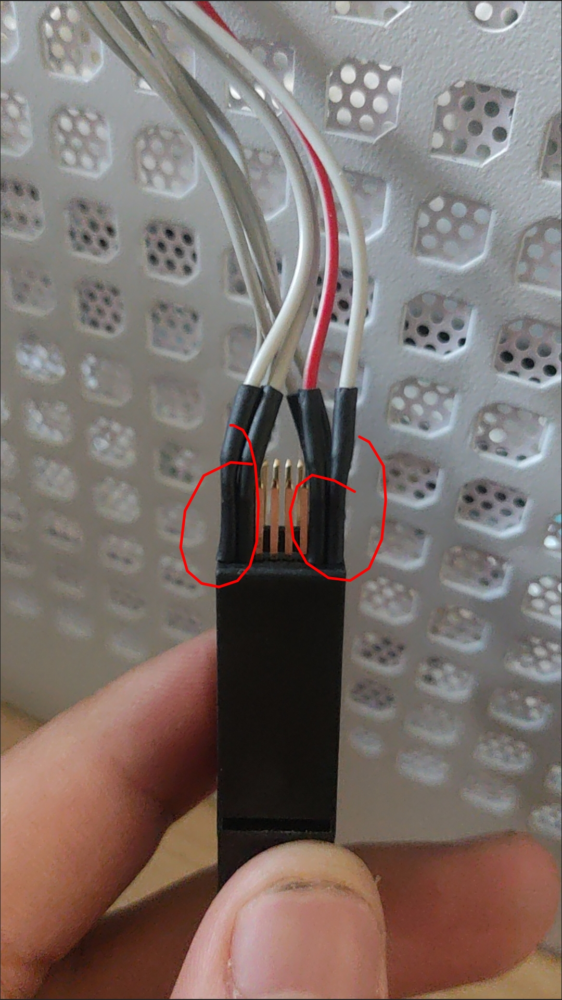
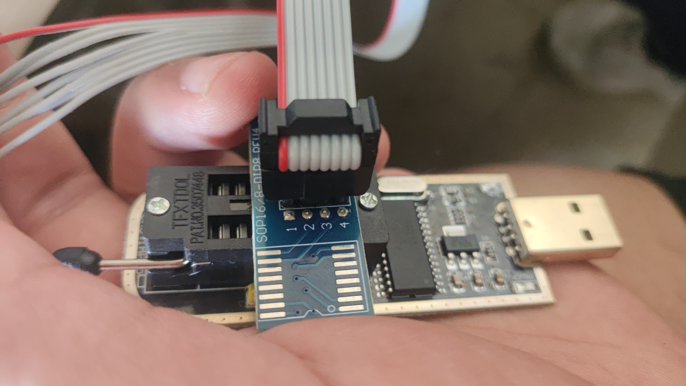
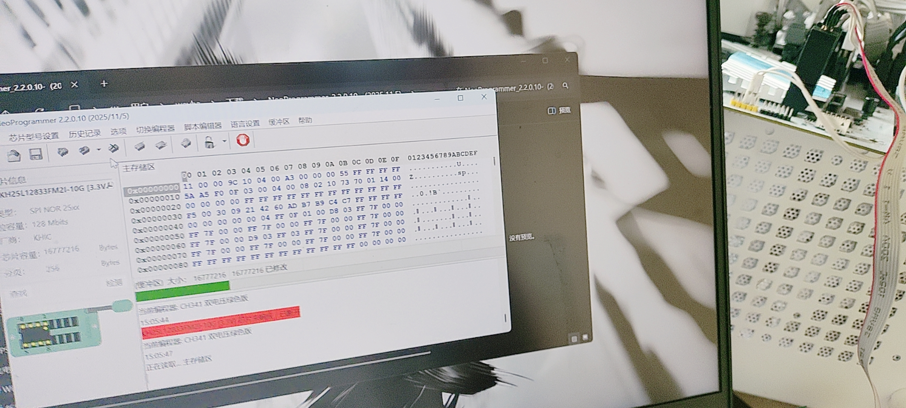
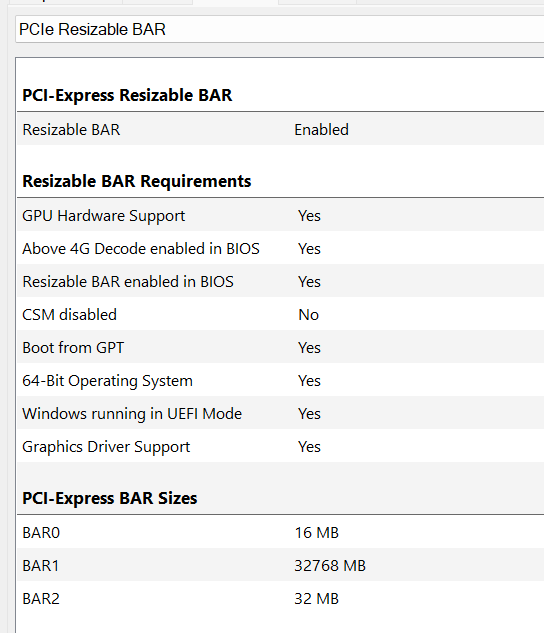

# 用 AI Agent 魔改主板 BIOS 给 20 系显卡开 ReBAR（精粤 Z690M Snow Dream D4）

> 一次刷砖 → 编程器救回 → 复盘定位根因 → 最终成功，完整记录 + 可复用工具链

**硬件**：精粤 Z690M Snow Dream D4 ｜ i7-14700KF ｜ 改装 22GB RTX 2080 Ti
**结果**：ReBAR 开启成功，BAR1 = 32 GiB（GPU-Z 显示 Enabled）

---

## ⚠️ 先说风险，别跳过

- **刷写主板固件有不可逆风险。** 本项目作者在本板子上**刷砖过一次**，靠 SPI 编程器（CH341A + SOP8 夹子）救回。
- **没有编程器就不要动手。** 精粤这类小厂主板**没有 USB Flashback**，BIOS 区一坏就只能拆芯片。
- 本文/本工具链**只针对「精粤 Z690M Snow Dream D4 + BIOS JYZ6PA08」**。换板子、换 BIOS 版本，请重新自己做全套校验，**不要直接套用**。
- 仓库里的脚本是**我的实际过程记录**，不是通用工具。用之前请逐行读懂。
- 一切后果自负。

---

## 📁 仓库结构

| 目录 | 内容 |
|---|---|
| `scripts/` | 纯 Python 的固件解析／注入／验证工具链（不需要 UEFITool 也能跑） |
| `tools/` | Windows 端一键脚本：`enable_rebar.bat` / `check_rebar.bat` |
| `images/` | 实拍图：编程器救砖现场、GPU-Z 验证、夹子 |
| `docs/` | 浓缩版文章、ReBAR 恢复操作单 |

### 关于 NvStrapsReBar.exe（未随仓库分发）

Windows 端配置工具 `NvStrapsReBar.exe` 属于第三方项目，**本仓库不附带**，请自行到上游下载：

- 驱动 + 配置工具：<https://github.com/terminatorul/NvStrapsReBar>
- 底层 DXE 驱动：<https://github.com/xCuri0/ReBarUEFI>
- **必需版本：v0.3**（v0.4 是官方承认有 bug 的 RC，读不到 EFI 变量）

下载后放进 `tools/` 目录，`enable_rebar.bat` 即可一键调用。

### 关于 BIOS 镜像

本仓库默认**不附带任何完整 BIOS 镜像**（厂商固件版权 + 每块板子的 ME/NVRAM 区域含本机数据）。

**推荐做法：用你从精粤官网下载的官方 BIOS，跑 `scripts/` 里的脚本自己生成**，这样得到的镜像才和你自己的板子匹配。

---

## 🧭 目录

- [一、我在 H610 上手改成功过，所以这次大意了](#一我在-h610-上手改成功过所以这次大意了)
- [二、买编程器、救回来、让 AI 复盘](#二买编程器救回来让-ai-复盘)
- [三、ReBAR 真正开起来](#三rebar-真正开起来)
- [四、ReBAR 开完之后，才是真正的麻烦](#四rebar-开完之后才是真正的麻烦)
- [五、最后说两句](#最后说两句)
- [六、技术附录](#6-技术附录给硬核读者)
- [七、工具链与复现步骤](#7-工具链与复现步骤)

---

# 如何正确用 AI 修改主板 BIOS：给 20 系显卡开 ReBAR（含翻车全过程）

> 主板：精粤 Z690M Snow Dream D4　｜　CPU：i7-14700KF　｜　显卡：改装 22GB 的 RTX 2080 Ti
> 结果：ReBAR 成功开启，BAR1 = 32 GiB
> 代价：刷砖一次、买了一块编程器、夹子买了两回

**先说清楚这篇是什么。** 它不是一个"ReBAR 保姆级教程"，而是我这次**让 AI 帮我改 BIOS、结果刷砖、又一步步救回来**的完整复盘。我更想聊的是中间那件事：**怎么跟 AI 说，它才能把这活儿干对**。

想直接抄操作步骤的，跳到第三部分。

**先补一句背景，不知道 ReBAR 是啥的看这段就够：**

RTX 20 系（Turing）其实硬件上支持 Resizable BAR，但出厂没开。想开只能从显卡侧改——而 20 系的 vBIOS 有签名、还加密，**根本改不了**。所以唯一的办法是绕一圈：**往主板 UEFI 里注入一个驱动**（叫 NvStrapsReBar），在开机枚举 PCIe 设备的时候，把显卡 BAR 窗口的大小改掉。

一句话：**想给显卡开 ReBAR，得去改主板。** 这就是这事又难又危险的原因。

---

## 第一部分：我在 H610 上手改成功过，所以这次大意了

这事得从之前说起。

我在精粤的 H610 上，**自己手动改过 BIOS，一次就成了**。所以这次上 Z690M，我心里是有底的——不就是同一套流程嘛。区别只在于我懒得自己抠那些字节了，想着现在 AI 这么强，直接让它帮我改，我照着刷就行。

**这就是我大意的开始。**

AI 给我的方案大概是这样：把驱动插到压缩 DXE 卷的尾部，卷空间不够，那就把内层 FV 的长度字段从 `0xFEB000` 扩到 `0xFF0000`，重新算校验和，重新压缩，打包。

说实话，这个方案**看起来特别合理**。空间不够就扩卷，这不是最直觉的做法吗？而且它该算的校验和都算了，还自己写了个验证脚本，跑完告诉我：全部通过。

我看了两遍，没挑出问题，然后就刷了。

**然后就是黑屏。**

不是那种"进系统蓝屏"的黑屏，是**开机之后整机一点反应都没有**——只有风扇在转，机箱灯亮着，但 BIOS 界面死活出不来，键盘灯都不带闪的。**直接不 POST。**

我第一反应是清 CMOS——抠电池、短接针脚、等了好几分钟，再来一次。

**没用。一点用都没有。**

那一刻的心情大概就是：完了，这板子废了。

后来我才明白一件事，也是这次第一课：**清 CMOS 只能救"设置错了"，救不了"固件本身坏了"。** 我这种情况属于卷结构被改坏、DXE 驱动全都不加载，BIOS 根本没跑到能响应 CMOS 复位那一步。方向从一开始就错了，白折腾。

---

## 第二部分：买编程器、救回来、让 AI 复盘

### 2.1 夹子买了两回

板子黑了就只能上编程器——把主板上的 SPI flash 芯片直接夹住，硬读硬写。这是最后的底牌，也是我在动手之前就确认过"实在不行还有这条路"的原因。

结果第一关就卡住了。

商家先给我发的是 **SOP16 的夹子**，我拿到手往芯片上一夹——**接不上**。板子上那颗芯片是 **SOP8 封装**的，8 个脚，16 脚的根本对不上。



*图：夹子买了两回——这张是先发错的那个*

没办法，只能退回去重买。这回买了 **SOP8 的**，夹上去正好，能读了。



*图：换对之后才能夹住芯片*

> **小提醒**：动手之前一定先确认自己板子上 flash 芯片的封装。别像我一样，板子黑着等夹子，还等错了一个。

### 2.2 电脑全黑了，数据怎么传出来？我用室友的电脑开了个局域网

这里有个当时挺关键的操作。

我自己的电脑已经彻底不亮了，而编程器读出来的那份"刷坏时的芯片内容"，**必须完整传到 AI 那边去分析**。所以我直接用**室友的电脑**，在本地开了一个局域网的文件接收服务，把整片 dump 传了出来。

现在回头看，这一步可能是整件事**最关键的转折**——因为**没有这份"失败现场"的数据，AI 根本没得复盘**，只能靠我描述"刷完黑了"，那它说什么都是猜。



*图：救砖现场，芯片型号 W25Q128JVSIQ（16MB）*

### 2.3 AI 是怎么发现问题的（这段我觉得最值得看）

拿到 dump 之后，AI 没急着下结论，它先做了件让我意外的事：**它先怀疑这份数据本身是不是可信的。**

它列了几条疑点：

- 数据只到 `0x6ACAC` 就断了，后面全变成 `FF`
- `0x100000` 到 `0x200000` 这一大段本该是 ME 固件，结果 **100% 都是 FF**
- ME 的 manifest 区中间出现了一个 2KB 的空洞
- 截断点的前一个字节只有 1 个 bit 偏差，而且截断点**不是块对齐的**

它的结论是：**这是"读取失败"的典型指纹，所以不能用这份 dump 去证明"写入失败了"。**

我当时还愣了一下——我辛辛苦苦传过来的数据，你告诉我它不可信？但仔细想想，这反而是对的。**如果它拿着半截数据就开始给我分析，后面全是瞎猜。**

于是它转了个方向：既然失败现场读不干净，那就**从镜像本身的结构去查**。最后定位到那句我现在还记得清清楚楚的结论：

> **`FvLength` 改了，但 `BlockMap` 没跟着改。**

具体是这样：

```diff
 FvLength: 0xFEB000  →  0xFF0000     ← 改了
 BlockMap: 0xFEB × 0x1000            ← 忘了改（还是 0xFEB000）
```

这是 UEFITool 作者 CodeRush 的原话：

> BlockSize × NumBlocks == FvLength 是硬校验，只改 FvLength 不改 NumBlocks 正是 UEFITool 会报警的典型错误。

**故障链条是这样的：**

```
只改 FvLength，BlockMap 没同步
  → 固件取两者里更小的那个当真实卷大小
  → 新插进去的模块落在卷外面
  → 这个卷被判定损坏
  → 卷里所有 DXE 驱动全部不加载
  → 黑屏，不 POST
```

跟我的症状完全对得上。

### 2.4 这里必须说一下模型的事

第一部分给我的那个"扩卷方案"，是 **GLM 5.3 Flash** 给的。翻车之后我换成了 **DeepSeek V4.1 Flash**，复盘能力完全是两个档次。

差别不在于"会不会写这段代码"，而在**做事的方式**：

| | GLM 5.3 Flash | DeepSeek V4.1 Flash |
|---|---|---|
| 方案从哪来 | 自己推演一套"看起来合理"的做法 | 先去翻官方 wiki、GitHub issue、社区踩坑帖，再定方案 |
| 对风险的态度 | 构建成功 = 成功 | 会主动说"这一步有 no POST 的风险" |
| 验证方式 | 自己写个脚本说"通过"就算过 | 多路交叉验证，还会指出"FPT 自带的 verify 不能当证据" |
| 数据可信度 | 直接下结论 | **先质疑数据本身是否可信**（就是我上面说的那步） |
| 不确定性 | 给个结论 | 会明确标注"这条还没实测" |

最让我服气的是：后来它**自己发现了自己构建脚本里的一个 bug**——写 section 尺寸时多写了一个字节，把 type 字段冲成了 `0x00`，结果被它自己的验证脚本拦下来了。

**换模型这一下，是整件事从"越修越烂"变成"能收场"的分水岭。**

> 📷 图 5 位：这里放和 AI 对话的聊天记录截图（复盘完成的地方）

### 2.5 按新方案重做，终于开机了

复盘完之后它给了修正版：**把 BlockMap 从 `0xFEB` 改成 `0xFF0`**（正好等于新的 `0xFF0000`），然后重算 FV 头的 16-bit 校验和。

跟刷砖那版的差别，就只有这 4 个字节加 2 个校验字节。

重刷——**开机了，正常进系统。**

那一刻的感觉就是：从"板子废了"到"活了"，中间隔着一份 dump 和一次正确的复盘。

到这一步，至少**不会再变砖了**。但 ReBAR 还没开起来。

---

## 第三部分：ReBAR 真正开起来

### 3.1 从"不再变砖"到"零风险"：v3 换了个思路

修正版（我们叫它 v2）只是把那个错误修掉了，本质还是**动了卷结构**。前面查资料的时候还挖到一条官方警告：

> 用 UEFITool 改卷结构，在某些固件上会导致 no POST。

而且这个镜像本身就被 UEFITool 判定为**"pad file 脆弱型"**：

```
non-empty pad-file contents will be destroyed after volume modifications
```

翻译过来就是：这种固件你别碰它的卷结构。

所以最终版（v3）换了思路——**一点都不动结构，只往空闲地方塞**：

1. 扫全镜像，找哪些卷还有空地方
2. 把驱动塞进 **FVMAIN 的空闲区**（偏移 `0x80CA40`）
3. **FV 头、卷尺寸、BlockMap、pad file、压缩子卷——全部原样不动**

结果对比一下就很清楚：

| | v1（刷砖那版） | **v3（最终成功）** |
|---|---|---|
| 改了什么 | 扩内层 FV 尺寸 + 插驱动 | 只在空闲区插驱动 |
| 卷结构 | 改了，而且改错了 | **完全没动** |
| UEFI 树与原版的差异 | 一堆结构变化 | **恰好 3 行** |
| 结果 | 黑屏不 POST | 正常开机 |

那"3 行差异"长这样：

```
> File    | DXE driver   | ... | NvStrapsReBar
> Section | PE32 image   | ... | PE32 image section
> Section | UI           | ... | UI section
```

就多出来一个驱动，别的什么都没变。**这 3 行 diff 就是"我没把你板子改坏"的证明。**

### 3.2 刷完别只看"能开机"

这次我没接受"能开机就算成功"，要求做硬验证。做法是：**把整片芯片读回来**，跟镜像**逐区域比对**。

结论：

- Flash Descriptor、ME 区、FVMAIN 头、压缩 DXE 子卷、微码 FV、PEI 区 → **全部字节级一致**
- 注入的那段 `0x80CA40–0x80FF7C` → **逐字节相同**
- 所有 FV 头校验和、BlockMap 与 FvLength 全部自洽

顺便还纠正了我一个认知：**FPT 自带的 verify 功能，不能当作"镜像正确"的证明**，它只验证写入过程，不验证你的镜像合不合规范。

> 这种活，**"能开机"不是验收标准，字节级一致才是。**

### 3.3 ⚠️ 这一步最容易做错：别用自动设置，会卡在 16G

驱动刷进 BIOS 只是把"能力"装进去了，**ReBAR 要真正生效，还得在 Windows 里跑工具写配置**。

这里我踩过一个坑，写出来给后面的人省事：

**别直接点 `E`（Turing 自动设置）。** 工具会按 2080 Ti 的标准档给你一套值，**Target BAR 只有 16 GiB**。对于原厂 11GB 的 2080 Ti 勉强够，但我这块是改装 22GB 的，16G 的窗口**根本盖不住显存**——你这么配，最多也就开到 16G。

**正确的做法：**

1. 管理员运行配置工具
2. **先选中你要配的那块显卡**（不要跳过去点自动）
3. 进**手动设置 ReBAR 尺寸**
4. **选 32G**
5. 保存（`S`），退出，**重启**

重启之后验证：

```
nvidia-smi -q -d memory | findstr /C:"BAR1" -A 3
```

看到 **Total = 32768 MiB** 就对了。



*图：GPU-Z 面板，Resizable BAR = Enabled，BAR1 = 32768 MB*

### 3.4 一个必须知道的维护事项

**以后每次刷 BIOS、清 CMOS、或者在 BIOS 里载入默认值，ReBAR 都会掉，必须重配一遍。**

这不是出错，是必然的。原因我后面第四部分讲。

---

## 第四部分：ReBAR 开完之后，才是真正的麻烦

ReBAR 是开起来了，但我没想到后面还有一连串的坑等着。而且这些坑，说实话，**都不比改 BIOS 简单**。

### 4.1 安全启动开不了：2026 年的证书换代

ReBAR 搞定之后，我想顺手把 Secure Boot 打开。结果一开就出问题：

重启直接报错——

```
Secure Boot Violation
Invalid signature detected. Check Secure Boot Policy in Setup
```

关掉 Secure Boot 才能进系统。

AI 排查后的结论是：**撞上了 2026 年 Secure Boot 证书换代。**

讲得通俗点：

- 系统里负责启动的那个 `bootmgfw.efi`，在 2026 年 7 月的那次更新之后，已经换成了**只用"Windows UEFI CA 2023"签名**，**不带 2011 的回退签名了**
- 但我主板固件里的信任列表（db）里，**只有 2011 那两张证书**
- 于是固件验签失败，直接把启动项拦了

**更麻烦的是这里：** 微软本来有个自动更新机制（KB5085046），会把新证书写进固件——但它有个前提：**"Secure Boot 必须已经在固件里开启"**。而我现在正因为证书旧所以开不了……**死锁了。**

而且还有个更深的坑：这个板子的固件**对系统隐藏了 db 和 dbx 变量**。我们试了三种不同的调用方式去读写，`SecureBoot`、`PK`、`KEK` 都能正常读，唯独 **db/dbx 一律返回"变量不存在"**。也就是说，**从 Windows 里根本写不进去**。

所以只能走两条路：BIOS 里手动导入证书，或者用官方的修复工具从 U 盘启动写入。

**最后是用官方的 `SecureBootRecovery.efi`，做成 U 盘启动盘搞定的。**

> 📷 图 6 位：SecureBootRecovery 走 U 盘的画面（可选）

结果：Secure Boot 正常开启，db 从 3143 字节变成 4641 字节——**正好多出那张 2023 证书的大小**，启动项签名验证通过，系统正常启动。

顺手还挖到一个反直觉的结论，这个很重要：

| 变量类型 | 例子 | 刷 BIOS / 清 CMOS 之后 |
|---|---|---|
| **认证变量**（带 TIME_BASED_AUTHENTICATED_WRITE） | `PK` / `KEK` / `db` / `dbx` | **不会丢**（固件自己删不掉） |
| **普通第三方变量** | `NvStrapsReBar` 的配置 | **必被清掉** |

所以我前面说"刷完 BIOS 要重配 ReBAR"就是这个原因——**ReBAR 的配置属于第二类，必丢**；而 Secure Boot 的证书属于第一类，**不用重做**。

我一开始的结论是反的（以为刷 BIOS 会把证书冲掉），后来拿两个证据推翻了自己：原厂镜像里一张新证书都没有，可刷完芯片里却有 4 张；固件内建默认库（`dbDefault`/`KEKDefault`）里也只有 2011 的。**那证书只可能是被"保留"下来的。**

### 4.2 接着又是 Windows 激活失败

Secure Boot 弄好之后，我又发现 Windows 没激活了，报 `0x803F7001`。

学校那个正版化客户端跑一遍，提示"安装激活密钥失败"，然后激活失败。

查它自己的日志，问题一目了然：

```
20:32:13  gvlk: ""                ← 学校服务器返回的密钥是空的
20:32:14  kmsHost = "10.1.70.72"  kmsPort = 1688
20:32:15  errorCode = 2151641089  ← 也就是 0x803F7001
```

**服务器把 KMS 客户端密钥返回成了空字符串。** 客户端拿不到密钥，自然装不上，接着激活就报"找不到有效许可证"。

再对比一下历史日志就更有意思了：2026 年 1 月的时候，服务器是正常下发密钥的，当时也激活成功了。**中间我在 5 月重装过一次系统（注册表里的 InstallDate 是 2026-05-07），密钥就没了；而服务器现在返回空值，客户端自己修不回来。**

顺带说明一下，这事跟前面折腾 BIOS 完全无关——我查了主板的 ACPI 表，**没有 MSDM 也没有 SLIC**，也就是说这板子本来就没有 OEM 密钥，激活跟固件一点关系都没有。

**解决方式：** 手动补上 KMS 客户端密钥（Windows 10/11 Pro 用的是同一把公开的 GVLK），指向学校的 KMS 服务器，再激活：

```bat
slmgr /ipk W269N-WFGWX-YVC9B-4J6C9-T83GX
slmgr /skms 10.1.70.72:1688
slmgr /ato
```

跑完之后验证，许可证状态从 `NOTIFICATION` 变成 `LICENSED`，学校客户端自己再跑一遍也显示"已授权"。**激活成功。**

---

## 最后说两句

回头看，这事最讽刺的地方是：**我在 H610 上自己手动改 BIOS，一次就成了；这次图省事交给 AI，直接刷砖。**

但真要说起来，问题不在"AI 行不行"，而在**我一开始是怎么用它**：

- 我第一轮只说了"帮我改 BIOS"，没告诉它**先去查别人踩过什么坑**，于是它自己发明了一套听着合理、实际会变砖的方案
- 我没要求它**说明白每一步为什么**，所以那个"4 个字节没同步"的问题，我根本没机会提前发现
- 我接受了一个**自己写的脚本说"通过"**的验证结果——自己验自己没有意义
- 反过来，后来真正把事做成的，是这几句：**"先全网搜，找最原始那一层，别自己发明"**、**"先说清你的理解再动手"**、**"不要只告诉我能开机，给我逐字节比对"**

还有一条我觉得挺关键的：**把"失败现场"完整交给它。** 板子黑着的时候我要是没把那份 dump 弄出来，AI 就只能对着我的一句"刷完黑了"猜，那这事大概率是收不了场的。

以及一个很现实的结论：**这类活，模型之间的差距会被放大。** 长链条、多步骤、还要自己做验证的任务上，"肯溯源、肯自我验证、肯承认不确定"比"聪明"重要得多。

最后是那句最重要的：

> **动手之前，先确认你有一个编程器。**
> 我这块板子没有 USB Flashback，BIOS 一坏就只能靠它。

---

## 附：几个能省时间的技术点

**六个必踩的坑**

| # | 坑 | 正解 |
|---|---|---|
| 1 | 只改 `FvLength` 不改 `BlockMap` | 两处一起改，并重算 FV 头 16-bit 校验和（偏移 `0x32`） |
| 2 | 以为清 CMOS 能救 | **结构性错误清 CMOS 无效**，只有编程器 |
| 3 | 往 pad file 脆弱型固件里改卷结构 | 挑**不用改结构**的空闲区插入 |
| 4 | LZMA 重压缩直接用 Python 默认输出 | Python 会写 unknown-size + EOS，**必须手写真实解压长度** |
| 5 | FFS 的 State 字节没按擦除极性翻转 | 看现有文件是 `0x07` 还是 `0xF8`，跟着翻 |
| 6 | 以为刷完一劳永逸 | 刷 BIOS / 清 CMOS / 载入默认值后都要重配 ReBAR |

**刷砖之后的抢救顺序（官方推荐，别一上来就编程器）**

1. 彻底断电清 CMOS——抠电池或短接针脚 **1–5 分钟**
2. **拔掉显卡，或者换个 PCIe 槽**——no POST 很多时候是显卡的 BAR 分配问题，**BIOS 其实还活着**
3. **进 BIOS 把日期改到 2024 年之前再启动**——驱动是用 RTC 年份判断 CMOS 是否被复位的
4. 都不行 → 编程器

**还有一条官方原话，抄作业的人一定要看：**

> if you make changes in UEFI Setup, NvStrapsReBar will be disabled automatically and you need to re-enable it.

**进 BIOS 改任何设置，ReBAR 都会自动关闭。**

**实测收益（说实话版）**

我这卡是 PCIe 3.0 ×16，大块 DMA 其实**早就跑满了**（H2D 11.85 / D2H 12.48 GB/s）。所以 ReBAR 的收益不在"搬得快不快"，而在驱动侧的小块随机访问。**别指望跑分暴涨，游戏收益看具体游戏。**

---

*本文记录的是个人在自有设备上的实践。刷写主板固件有不可逆风险，请自行评估，并做好完整备份。*

---

## 7. 工具链与复现步骤

### 前置条件

| 项 | 要求 |
|---|---|
| 主板 | 精粤 Z690M Snow Dream D4（其他板子请重做全套校验） |
| 官方 BIOS | `JYZ6PA08`（从精粤官网下载，带 Referer 才给下） |
| 刷写工具 | 你板子官方刷写包里的 `FPTW64.exe`（厂商包里的 `jy.bat` 就是 `fptw64 -f BIOS.rom -rewrite`） |
| 救砖兜底 | **SPI 编程器**（CH341A + SOP8 夹子）+ 完整的整片备份 |
| Python | 3.9+，标准库即可（`lzma` / `struct`） |

> ⚠️ 动手前**第一件事**：用 `fptw64 -d ORIG.bin` 把整片 16MB 读出来存好。这是你唯一的退路。

### 复现步骤

```bash
# 1) 解析固件结构，确认卷布局和空闲空间
python scripts/survey_fvs.py         ORIG.bin
python scripts/survey_fv_types.py    ORIG.bin

# 2) 生成注入版镜像（零结构改动策略：驱动插外层 FVMAIN 空闲区）
python scripts/build_v3.py           ORIG.bin JYZ6PA08_ReBAR_v3.bin

# 3) 结构校验（关键：BlockSize × NumBlocks == FvLength）
python scripts/check_fv_blockmap.py  JYZ6PA08_ReBAR_v3.bin

# 4) 全量比对：与原始镜像的差异必须全部落在插入区间内
python scripts/final_verify.py       ORIG.bin JYZ6PA08_ReBAR_v3.bin

# 5) 可选：重打包成厂商风格的 Windows 一键刷写 exe
python scripts/make_sfx.py           JYZ6PA08_ReBAR_v3.bin Z690M_Snow_Dream_D4_ReBAR.exe
```

刷入之后**必须回读比对**：

```bash
fptw64 -d after.bin
python scripts/fw_diff.py ORIG.bin after.bin
python scripts/diag_rebar_lost.py after.bin JYZ6PA08_ReBAR_v3.bin
```

再用 `tools/check_rebar.bat` 看 `BAR1` 是否变成 32768 MiB。

### 关键约束（踩过的坑，别重犯）

| # | 约束 | 原因 |
|---|---|---|
| 1 | 改 FV 尺寸时 **`BlockMap` 必须同步改**，并重算 FV 头 16-bit 校验和（偏移 `0x32`） | 只改 `FvLength` = 变砖（我踩的第一个坑） |
| 2 | **优先选"不动卷结构"的空闲区插入** | 本镜像属 pad file 脆弱型，改卷结构在某些固件上直接 no POST |
| 3 | LZMA 重压缩**必须手写真实解压长度** | Python `lzma.compress` 默认写 unknown-size + EOS，EDK2 解析会失败 |
| 4 | FFS 的 `State` 字节**要按擦除极性翻转** | 看现有文件是 `0x07` 还是 `0xF8`，跟着来 |
| 5 | FPT 自带的 verify **不能当作镜像正确性的证明** | 必须回读整片 + 逐字节比对 |
| 6 | 刷 BIOS / 清 CMOS / 载入默认值后 **ReBAR 配置必丢** | 第三方变量会被清；认证变量（证书）不会 |

---

## 🧾 致谢与许可

- 驱动与思路来自：[terminatorul/NvStrapsReBar](https://github.com/terminatorul/NvStrapsReBar)、[xCuri0/ReBarUEFI](https://github.com/xCuri0/ReBarUEFI)，版权归原作者所有。
- `scripts/` 与文档为本项目作者原创，采用 **MIT** 许可（见 `LICENSE`）。
- `images/` 为作者实拍，可自由转载，注明出处即可。
- 文中提到的厂商固件（精粤 BIOS）版权归精粤所有，本仓库不再分发。

## 免责声明

本项目为个人在自有设备上的实践记录。刷写主板固件可能导致设备损坏、数据丢失、保修失效。
**请自行评估风险，做好完整备份（尤其是一个能用的编程器）。** 作者不对任何后果负责。
